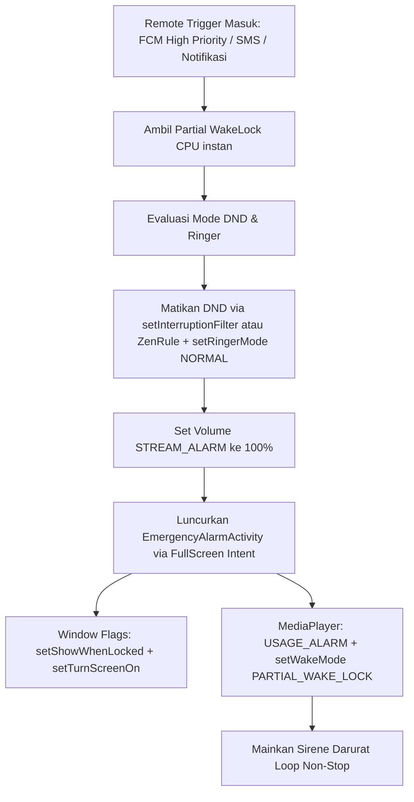

# LAPORAN TEKNIS REVERSE ENGINEERING: MACRODROID (v6.0.11)
**Target Berkas:** `com.arlosoft.macrodroid` (base.apk)  
**Tujuan Analisis:** Implementasi Penembusan Silent/DND, Remote Trigger (Webhook/SMS/Notifikasi), serta Fullscreen Alarm & MediaPlayer Audio Routing.

---

## 1. PENEMBUSAN MODE SENYAP (SILENT / DND BYPASS) & VOLUME FORCING

### 1.1. Perubahan Ringer Mode & Pelepasan Mode Hening
Berdasarkan dekompilasi pada kelas `com.arlosoft.macrodroid.action.SilentModeVibrateOffAction`:
- **API Inti:** `AudioManager.setRingerMode(int ringerMode)`
- **Konstanta Normal:** `AudioManager.RINGER_MODE_NORMAL` (`2`).
- **Mekanisme Eksekusi:**
  ```java
  AudioManager audioManager = (AudioManager) getContext().getSystemService("audio");
  if (this.option != 0) { // Un-mute / Matikan Mode Senyap
      audioManager.setRingerMode(AudioManager.RINGER_MODE_NORMAL); // 2
  }
  // Menghidupkan getar saat dering jika diinginkan
  Settings.System.putInt(getContext().getContentResolver(), "vibrate_when_ringing", 1);
  ```
- **Ketentuan Hak Akses:**
  Mulai dari Android 7.0 (API 24 / Nougat), memanggil `setRingerMode` untuk keluar dari hening saat DND aktif akan melempar `SecurityException` kecuali aplikasi memiliki izin `ACCESS_NOTIFICATION_POLICY`. MacroDroid memvalidasi izin ini:
  ```java
  NotificationManager notificationManager = (NotificationManager) getContext().getSystemService("notification");
  if (!notificationManager.isNotificationPolicyAccessGranted()) {
      Intent intent = new Intent(Settings.ACTION_NOTIFICATION_POLICY_ACCESS_SETTINGS);
      intent.addFlags(Intent.FLAG_ACTIVITY_NEW_TASK);
      context.startActivity(intent);
  }
  ```

---

### 1.2. Penembusan DND (Do Not Disturb / Interruption Filter)
Ditemukan pada dekompilasi kelas `com.arlosoft.macrodroid.action.SetPriorityMode` dan `AlwaysOnDndService`:

#### A. Penanganan untuk Android < 15 (SDK < 35)
MacroDroid menggunakan API standar `NotificationManager.setInterruptionFilter()`:
```java
NotificationManager notificationManager = (NotificationManager) getContext().getSystemService("notification");
// 1 = INTERRUPTION_FILTER_ALL (Semua suara & notifikasi tembus / DND Mati)
// 2 = INTERRUPTION_FILTER_PRIORITY (Hanya prioritas)
// 3 = INTERRUPTION_FILTER_NONE (Total hening)
// 4 = INTERRUPTION_FILTER_ALARMS (Alarm tetap berdering)
notificationManager.setInterruptionFilter(NotificationManager.INTERRUPTION_FILTER_ALL);
```

#### B. Penanganan Khusus Android 15+ (SDK >= 35)
Pada Android 15, Google membatasi aplikasi pihak ketiga agar tidak bisa langsung memanggil `setInterruptionFilter` secara global sembarangan. MacroDroid mengatasi ini dengan arsitektur **AutomaticZenRule** dan **ConditionProviderService**:
1. Mendeklarasikan `AlwaysOnDndService` yang meng-extend `android.service.notification.ConditionProviderService` dengan permission `android.permission.BIND_CONDITION_PROVIDER_SERVICE` di `AndroidManifest.xml`.
2. Mendaftarkan aturan Zen otomatis (`AutomaticZenRule`):
   ```java
   AutomaticZenRule rule = new AutomaticZenRule.Builder(
       "MacroDroid Specific Do Not Disturb Mode",
       new Uri.Builder().scheme("condition").authority(getPackageName()).appendPath("macrodroid_dnd").build()
   )
   .setManualInvocationAllowed(true)
   .setInterruptionFilter(NotificationManager.INTERRUPTION_FILTER_ALL)
   .setOwner(new ComponentName(getContext(), AlwaysOnDndService.class))
   .setEnabled(true)
   .build();
   
   String ruleId = notificationManager.addAutomaticZenRule(rule);
   ```
3. Mengontrol aktivasi kondisi melalui `AlwaysOnDndService`:
   ```java
   notifyCondition(new Condition(this.conditionUri, "DND Bypass Active", Condition.STATE_TRUE));
   ```

---

### 1.3. Pemaksaan Volume ke 100% (`SetVolumeAction`)
Ditemukan pada kelas `com.arlosoft.macrodroid.action.SetVolumeAction` dan `SetVolumeActivity`:
- **Konstanta Aliran Audio (`s_streamConstants`):**
  MacroDroid mendefinisikan array stream audio internal:
  - Indeks 0: `AudioManager.STREAM_ALARM` (`4`)
  - Indeks 1: `AudioManager.STREAM_MUSIC` (`3`)
  - Indeks 2: `AudioManager.STREAM_NOTIFICATION` (`5`)
  - Indeks 3: `AudioManager.STREAM_RING` (`2`)
  - Indeks 4: `AudioManager.STREAM_SYSTEM` (`1`)
  - Indeks 5: `AudioManager.STREAM_VOICE_CALL` (`0`)

- **Rumus Normalisasi Persentase ke Index Aktual:**
  Hardware Android memiliki batasan `getStreamMaxVolume(streamType)` yang bervariasi (misal 7 langkah atau 15 langkah). MacroDroid menghitung konversi desimal persentase (0–100%) ke nilai index audio dengan rumus presisi pembulatan tengah:
  ```java
  int maxVolume = audioManager.getStreamMaxVolume(streamType);
  double step = 100.0d / (double) maxVolume;
  int targetVolumeIndex = (int) (((step / 2.0d) + (maxVolume * targetPercent)) / 100.0d);
  
  // Memaksa volume ke targetVolumeIndex tanpa memunculkan UI slider sistem (flags = 0)
  audioManager.setStreamVolume(streamType, targetVolumeIndex, 0);
  ```

- **Trik "Foreground Activity Bypass" (`SetVolumeActivity`):**
  Pada Android 10+ dan OEM tertentu (seperti Samsung OneUI dan Xiaomi MIUI/HyperOS), perintah `setStreamVolume` dari background service sering kali diabaikan atau dibatasi bila sistem berada di mode hemat baterai.
  MacroDroid mengatasinya dengan trik cerdas:
  1. Jika opsi `setInForeground` aktif, ia menjalankan `SetVolumeActivity` dengan flag `FLAG_ACTIVITY_NEW_TASK | FLAG_ACTIVITY_CLEAR_TOP | FLAG_ACTIVITY_EXCLUDE_FROM_RECENTS`.
  2. `SetVolumeActivity` adalah Activity transparan tanpa judul (`requestWindowFeature(1)` dan flag `1024` / Fullscreen).
  3. Activity ini langsung mengeksekusi `audioManager.setStreamVolume(...)` dalam konteks Foreground Window resmi, lalu langsung menutup dirinya (`finish()`) dalam 50 milidetik.
  4. Untuk mendukung peluncuran Activity dari background ini di Xiaomi/Android modern, ia meminta izin `SYSTEM_ALERT_WINDOW` (`requiresCanDrawOverlays`) dan `requiresXiaomiBackgroundStart`.

---

## 2. PEMICU JARAK JAUH (REMOTE TRIGGERS)

### 2.1. Webhook via Firebase Cloud Messaging (FCM)
MacroDroid tidak membuka port HTTP server lokal yang rentan mati saat HP deep sleep/Doze. Sebagai gantinya, arsitekturnya bekerja secara Cloud-Relayed:
1. **Registrasi Token Push:**
   Pada `MacroDroidFirebaseMessagingService.onNewToken(String token)`:
   Aplikasi mengirimkan FCM push token perangkat ke server relay MacroDroid (`https://trigger.macrodroid.com/`).
2. **Penerimaan Push Eksekusi:**
   Saat webhook URL pengguna dipanggil dari luar (misal browser atau script HTTP), server MacroDroid memicu push data FCM berprioritas tinggi (`priority: high`).
3. **Penanganan Pesan Masuk (`e(RemoteMessage remoteMessage)`):**
   ```java
   Map<String, String> data = remoteMessage.getData();
   String triggerId = data.get("trigger_id");
   String ipAddress = data.get("ip");
   // Parsing payload JSON atau URL parameter menjadi dictionary variable lokal
   // Mencocokkan Macro yang memiliki WebHookTrigger aktif
   if (macro.canInvoke(triggerContextInfo)) {
       macro.setTriggerThatInvoked(webHookTrigger);
       macro.invokeActions(macro.getActions(), ...);
   }
   ```
   Karena pesan FCM bertipe data `high-priority`, Android mengalokasikan "High Priority FCM Quota" yang membangunkan CPU perangkat dari Doze Mode secara instan.

---

### 2.2. SMS Masuk (`IncomingSMSTriggerReceiver` & `IncomingSMSCheckerService`)
Untuk pemicu darurat tanpa koneksi internet (offline alarm):
1. **Penerima Siaran:**
   `IncomingSMSTriggerReceiver` meng-extend `WakefulBroadcastReceiver`.
   ```java
   Intent serviceIntent = new Intent(context, IncomingSMSCheckerService.class);
   serviceIntent.putExtras(intent.getExtras());
   WakefulBroadcastReceiver.startWakefulService(context, serviceIntent);
   ```
   `WakefulBroadcastReceiver` otomatis mengunci CPU dengan `PARTIAL_WAKE_LOCK` sehingga HP tidak tertidur di antara transmisi receiver ke service.
2. **Rekonstruksi Pesan PDU:**
   Pada `IncomingSMSCheckerService.onHandleIntent`:
   ```java
   Object[] pdus = (Object[]) intent.getExtras().get("pdus");
   SmsMessage[] messages = new SmsMessage[pdus.length];
   StringBuilder bodyBuilder = new StringBuilder();
   for (int i = 0; i < pdus.length; i++) {
       messages[i] = SmsMessage.createFromPdu((byte[]) pdus[i]);
       bodyBuilder.append(messages[i].getMessageBody());
   }
   String fullMessage = bodyBuilder.toString();
   String sender = messages[0].getDisplayOriginatingAddress();
   ```
3. **Deduplikasi Pesan:**
   MacroDroid membandingkan `body`, `sender`, dan `timestampMillis` dengan cache statis `lastMessage` untuk mencegah loop pemicu ganda dari siaran multi-part SMS.
4. **Penyelesaian Service:**
   Di akhir proses, memanggil `WakefulBroadcastReceiver.completeWakefulIntent(intent)` untuk melepaskan wake lock secara aman.

---

### 2.3. Pendeteksi Notifikasi Masuk (`NotificationService`)
MacroDroid meng-extend `android.service.notification.NotificationListenerService`:
- Berjalan sebagai service terspesialisasi yang dikelola langsung oleh Android OS.
- Mengimplementasikan `onNotificationPosted(StatusBarNotification sbn)`:
  ```java
  Notification notification = sbn.getNotification();
  Bundle extras = notification.extras;
  String title = extras.getString(Notification.EXTRA_TITLE);
  CharSequence text = extras.getCharSequence(Notification.EXTRA_TEXT);
  String packageName = sbn.getPackageName();
  // Filter teks darurat, misal keyword pesan WhatsApp / Telegram
  ```

---

## 3. PEMUTARAN AUDIO DARURAT (MEDIAPLAYER) & LAYAR PENUH DARURAT

### 3.1. Konfigurasi Pemutaran Audio Anti-Potong (`PlaySoundAction`)
Ditemukan pada `com.arlosoft.macrodroid.action.PlaySoundAction`:
1. **CPU WakeLock Spesifik:**
   Sebelum memutar, MacroDroid membuat WakeLock non-reference-counted untuk mencegah HP tertidur di tengah pemutaran audio:
   ```java
   PowerManager pm = (PowerManager) context.getSystemService(Context.POWER_SERVICE);
   PowerManager.WakeLock wakeLock = pm.newWakeLock(PowerManager.PARTIAL_WAKE_LOCK, "macrodroid:PlaySoundAction");
   wakeLock.setReferenceCounted(false);
   wakeLock.acquire(600000L); // Batas aman 10 menit
   ```
2. **Kopling WakeLock ke MediaPlayer:**
   ```java
   MediaPlayer mediaPlayer = new MediaPlayer();
   mediaPlayer.setWakeMode(context.getApplicationContext(), PowerManager.PARTIAL_WAKE_LOCK);
   ```
3. **Audio Routing Kebal DND (`STREAM_ALARM` / `USAGE_ALARM`):**
   - MacroDroid memetakan audio ke channel Alarm:
     ```java
     mediaPlayer.setAudioStreamType(AudioManager.STREAM_ALARM); // 4
     ```
   - *Rekomendasi Modern (Android 8+ / API 26+)*:
     ```java
     AudioAttributes audioAttributes = new AudioAttributes.Builder()
         .setUsage(AudioAttributes.USAGE_ALARM)
         .setContentType(AudioAttributes.CONTENT_TYPE_SONIFICATION)
         .setFlags(AudioAttributes.FLAG_AUDIBILITY_ENFORCED)
         .build();
     mediaPlayer.setAudioAttributes(audioAttributes);
     ```
     **Penting:** Aliran suara dengan atribut `USAGE_ALARM` diproteksi oleh kernel audio Android sehingga **TIDAK TERPENGARUH oleh mode DND atau hening standar**, kecuali mode "Total Silence" ekstrem.
4. **Permintaan Fokus Audio Eksklusif:**
   ```java
   audioManager.requestAudioFocus(
       null, 
       AudioManager.STREAM_ALARM, 
       AudioManager.AUDIOFOCUS_GAIN_TRANSIENT_MAY_DUCK
   );
   ```
5. **Fallback Watchdog:**
   MacroDroid membuat Handler fallback timer: durasi audio + 3 detik. Jika event `onCompletionListener` tidak terpicu (misal karena glitch hardware), watchdog akan otomatis menghentikan player dan melepas WakeLock.

---

### 3.2. Penembusan Layar Kunci & Fullscreen (`ScreenOnAction` & `ScreenOnActivity`)
Bagaimana MacroDroid menyalakan layar dari kondisi mati/terkunci?
1. **Flag WakeLock Tingkat Rendah:**
   Pada `ScreenOnAction.java`:
   ```java
   // Flag 805306378 (Hex: 0x3000000a)
   // 0x20000000 = PowerManager.ON_AFTER_WAKEUP
   // 0x10000000 = PowerManager.ACQUIRE_CAUSES_WAKEUP
   // 0x0000000a = PowerManager.SCREEN_BRIGHT_WAKE_LOCK
   powerManager.newWakeLock(
       PowerManager.SCREEN_BRIGHT_WAKE_LOCK | 
       PowerManager.ACQUIRE_CAUSES_WAKEUP | 
       PowerManager.ON_AFTER_WAKEUP,
       "macrodroid:screenonaction"
   ).acquire(1000L);
   ```
   Flag `ACQUIRE_CAUSES_WAKEUP` memaksa subsistem display menyala seketika saat lock diambil.

2. **Window Flag Penembus Layar Kunci (`ScreenOnActivity`):**
   ```java
   // Untuk Android 8.1+ (API 27+)
   if (Build.VERSION.SDK_INT >= Build.VERSION_CODES.O_MR1) {
       setTurnScreenOn(true);
       setShowWhenLocked(true);
   }
   
   // Nilai flag 2621569 (Hex: 0x00280081):
   // 0x00200000 = WindowManager.LayoutParams.FLAG_DISMISS_KEYGUARD
   // 0x00080000 = WindowManager.LayoutParams.FLAG_SHOW_WHEN_LOCKED
   // 0x00000080 = WindowManager.LayoutParams.FLAG_KEEP_SCREEN_ON
   // 0x00000001 = WindowManager.LayoutParams.FLAG_ALLOW_LOCK_WHILE_SCREEN_ON
   getWindow().addFlags(
       WindowManager.LayoutParams.FLAG_DISMISS_KEYGUARD |
       WindowManager.LayoutParams.FLAG_SHOW_WHEN_LOCKED |
       WindowManager.LayoutParams.FLAG_KEEP_SCREEN_ON |
       WindowManager.LayoutParams.FLAG_ALLOW_LOCK_WHILE_SCREEN_ON
   );
   ```

3. **Deklarasi Manifest untuk Full Screen Alarm:**
   ```xml
   <activity
       android:name=".EmergencyAlarmActivity"
       android:showOnLockScreen="true"
       android:turnScreenOn="true"
       android:showWhenLocked="true"
       android:inheritShowWhenLocked="true"
       android:excludeFromRecents="true"
       android:launchMode="singleInstance" />
   ```

---

## 4. CETAK BIRU REKOMENDASI UNTUK `COUPLE-REMOTE-ALARM`

Berdasarkan temuan reverse engineering ini, arsitektur yang wajib diadopsi untuk aplikasi alarm jarak jauh kita adalah:



1. **Triggering:** Gunakan FCM Data-only messages dengan `AndroidConfig.Priority.HIGH` untuk jaringan online, dan `BroadcastReceiver` SMS dengan `WakefulBroadcastReceiver` pattern untuk fallback offline.
2. **DND & Volume:** Minta izin `android.permission.ACCESS_NOTIFICATION_POLICY`. Saat alarm darurat terpicu:
   - Naikkan volume `STREAM_ALARM` ke level maksimum.
   - Set ringer mode ke `RINGER_MODE_NORMAL`.
   - Set interruption filter ke `INTERRUPTION_FILTER_ALL`.
3. **Playback:** Gunakan `AudioAttributes.USAGE_ALARM` dan pastikan `mediaPlayer.setWakeMode(context, PowerManager.PARTIAL_WAKE_LOCK)` aktif.
4. **Layar:** Pada Activity alarm darurat, terapkan `setShowWhenLocked(true)`, `setTurnScreenOn(true)`, serta flag window `FLAG_KEEP_SCREEN_ON` dan `FLAG_DISMISS_KEYGUARD`.
